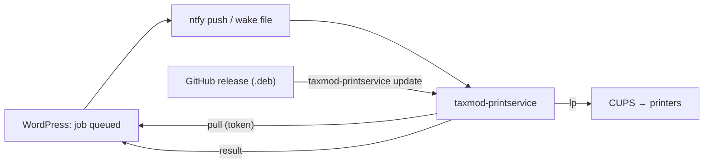

# Taxmod print service

Prints Taxmod labels at home: it fetches the print jobs from WordPress and hands them to CUPS. Packaged as a `.deb`
for Linux (D-1332 in the Taxmod decision log); it replaces the hand-copied script in `wp-taxonomy-modeler/tools/print-agent`.



## Install (once per machine)

```sh
wget https://github.com/sfambach/taxmod_printservice/releases/latest/download/taxmod-printservice_0.6.0_all.deb
sudo apt install ./taxmod-printservice_0.6.0_all.deb
```

1. In WordPress: **Taxmod › Configuration › Printing › Add print service** (or **Pairing code** at an existing one).
   The code holds 15 minutes and works once.
2. Open **Taxmod Druckdienst** from the menu, enter the website and the code, click **Koppeln**.
   Without a desktop: `taxmod-printservice pair https://www.fambach.net CODE`.
3. Once, as the user that prints: `taxmod-printservice setup` (starts the service, keeps it running without a login,
   turns off a hand-installed `taxmod-print-agent`, and moves a token still in `config.json` into the sealed file).

## Settings page

`taxmod-printservice ui` (the menu entry) serves http://127.0.0.1:8631 for this computer only: state, CUPS printers with
a test page, the latest jobs, this computer's settings (new tries, their distance, watch time), the log, and **Update**
(asks for the Linux password). Over ssh: `taxmod-printservice ui --no-browser` and `ssh -L 8631:127.0.0.1:8631 server`.

The token lives encrypted in `~/.config/taxmod-print-agent/token.enc` (openssl AES-256, key from this machine and user);
`config.json` holds the rest.

## New tries and pause

A printer with **Automatisch wiederholen** on (Taxmod model) gets a failed job taken out of CUPS and sent again, up to
«Neuversuche» times, «Abstand» seconds apart. A printer with a **pause** in the model gets its jobs one by one, the pause
after each (the Phomemo swallows labels sent too fast).

## Update

```sh
taxmod-printservice update --check   # is there a newer release?
taxmod-printservice update           # download and install it; asks for your Linux password
```

The package restarts the running service after an update.

## Release

Raise `VERSION` in `src/taxmod_print_agent.py`, commit, then run **Actions › Release › Run workflow** with `v<that version>` (or push that tag). The `Release` workflow runs the
tests, builds the `.deb` and attaches it to the GitHub release.

## Tests

`python3 -m unittest discover -s tests`

Printers, label sizes and CUPS options live in the Taxmod model (Logistik › Drucker), not here.

## Several computers

Every computer with printers runs its own service with its own access (Taxmod › Configuration › Printing › Add print
service). On each pull the service names the CUPS queues of its computer (`lpstat -e`), and WordPress hands it only the
jobs for those queues, plus the jobs that name no queue (D-1336). A computer whose CUPS lists no queue does not pull.
