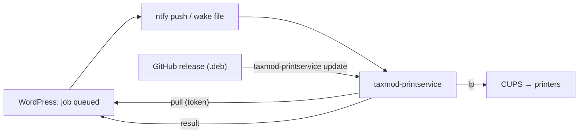

# Taxmod print service

Prints Taxmod labels at home: it fetches the print jobs from WordPress and hands them to CUPS. Packaged as a `.deb`
for Linux (D-1332 in the Taxmod decision log); it replaces the hand-copied script in `wp-taxonomy-modeler/tools/print-agent`.



## Install (once per machine)

1. Download `taxmod-printservice_<version>_all.deb` from the [newest release](https://github.com/sfambach/taxmod_printservice/releases/latest).
2. Install it: double-click it, or `sudo apt install ./taxmod-printservice_<version>_all.deb`.
3. As the user that prints (not root): `taxmod-printservice setup`.
   - Without a config it writes `~/.config/taxmod-print-agent/config.json`; fill in `rest`, `token`, `ntfy` and
     `wake_url` from **Taxmod › Configuration › Printing › Set up access**, then run `setup` again.
   - An existing config from the hand-installed script is used as it is; the old `taxmod-print-agent` service is
     turned off so only one service prints.
   - It starts the service and keeps it running without a login (`loginctl enable-linger`).

Log: `journalctl --user -u taxmod-printservice -f`. One pull by hand: `taxmod-printservice once`.

## Update

```sh
taxmod-printservice update --check   # is there a newer release?
taxmod-printservice update           # download and install it; asks for your Linux password
```

The package restarts the running service after an update.

## Release

Raise `VERSION` in `src/taxmod_print_agent.py`, commit, then run **Actions › Release › Run workflow** with `v<that version>` (or push that tag). The `Release` workflow runs the
tests, builds the `.deb` and attaches it to the GitHub release.

## Tests

`python3 -m unittest discover -s tests`

Printers, label sizes and CUPS options live in the Taxmod model (Logistik › Drucker), not here.

## Several computers

Every computer with printers runs its own service with its own access (Taxmod › Configuration › Printing › Add print
service). On each pull the service names the CUPS queues of its computer (`lpstat -e`), and WordPress hands it only the
jobs for those queues, plus the jobs that name no queue (D-1336). A computer whose CUPS lists no queue does not pull.
